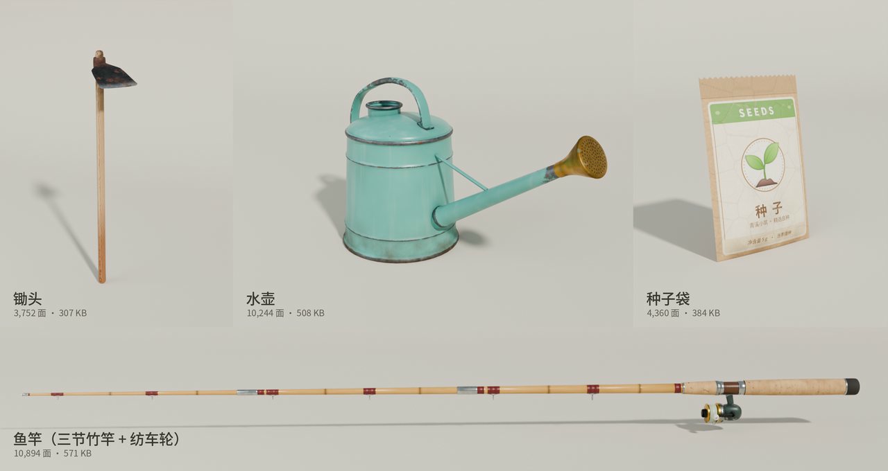
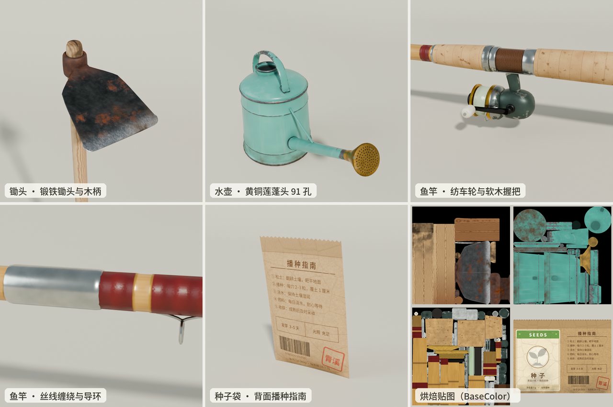
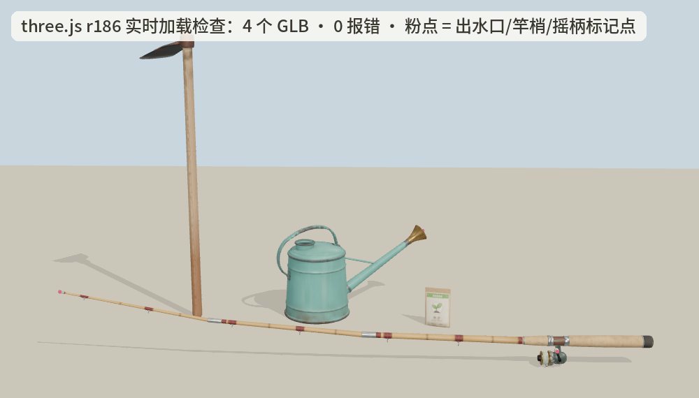

# 青溪小筑 · 模型源文件

游戏里用到的 3D 模型的源文件：

- **四件工具**（锄头、水壶、鱼竿、种子袋）：全部在 **Blender 4.5** 里用 Python 脚本程序化建模、程序化材质，再烘焙成 PBR 贴图并导出 glTF（GLB）。
- **主角人物**（戴渔夫帽、穿休闲装的青年，带 53 根骨骼的游戏骨架）：用 MakeHuman 人体（CC0）在 Blender + MPFB 2 里生成，渔夫帽为脚本建模，详见 [character/README.md](character/README.md)。
- **两层木屋**：在 **Blender 5.1.2**（`D:\blander\blender.exe`）里用 `source/house/` 的脚本程序化建模、布局、材质和 AO，导出约 11.4 万三角面的 GLB，同时写 `src/assets/houseLayout.js`；游戏里可走进去，一楼壁炉/厨房/餐桌/阅读角，二楼卧室和床。








## 目录

```
models/
  blend/*.blend.b64     Blender 工程（贴图已打包进文件，WebP 格式）
                        人物较大，拆成 farmer.blend.b64.part1…6；木屋拆成 house.blend.b64.part1…4
  glb/*.glb.b64         工具：Blender 直接导出的 GLB（完整精度，可导入其他引擎 / 软件）
                        人物：游戏里用的 GLB（Meshopt + WebP），拆成 farmer.glb.b64.part1…2
                        木屋：游戏里用的 GLB（Meshopt + WebP），拆成 house.glb.b64.part1…3
  source/               工具的全部生成脚本；source/house/ 是木屋的脚本（house.py / arch.py / furn.py / geo.py / tex.py）
  character/            人物的生成脚本和说明（README.md）
  game_export/          工具 / 木屋 GLB → 游戏资源：压缩（Meshopt + WebP）并写成 src/assets/*.js；木屋用 house_pack.mjs + emit_house.mjs
  preview/              上面几张预览图
  decode.py             一键还原：.b64（含分段的 .b64.partN）→ .blend / .glb，以及游戏 ../dist/青溪小筑.html
  encode.py             反过来：把文件编码成 base64 分段（每段 100 万字符）并更新 checksums.md5
  checksums.md5         还原后用来校验的 md5
```

## 下载后先还原二进制文件

GitHub 网页接口只能提交文本，单个文件也不能太大，所以 `.blend`、`.glb` 和游戏单文件都以 base64 文本存放（内容完全一致，只是编码不同），较大的拆成了几段（现在已改用本地 git 命令行提交，以后可以直接提交二进制，见根目录 `开发交接.md` 7.4；改之前仍按下面的方法还原）。下载仓库后在 `models/` 目录运行：

```bash
python3 decode.py            # Windows 上用 python decode.py
python3 decode.py game       # 只还原游戏；blend / glb 同理
```

会还原出下面这些文件（分段自动按顺序拼接，并按 `checksums.md5` 校验；有分段缺失或损坏会提示是哪个文件，不会写出坏文件）：

| 文件 | 来源 | 打开方式 |
|---|---|---|
| `../dist/青溪小筑.html` | 8 段 | 双击用浏览器打开就能玩 |
| `blend/hoe.blend` `can.blend` `rod.blend` `packet.blend` | 各 1 段 | Blender 4.5 |
| `blend/farmer.blend` | 6 段 | Blender 4.5 |
| `blend/house.blend` | 4 段 | Blender 5.1.2 |
| `glb/hoe.glb` `can.glb` `rod.glb` `packet.glb` | 各 1 段 | 任意 glTF 查看器 / 引擎，也可导入 Blender |
| `glb/farmer.glb` | 2 段 | three.js、Babylon.js、[glTF Viewer](https://gltf-viewer.donmccurdy.com) 等（用了 Meshopt 压缩，Blender 请直接打开 `farmer.blend`） |
| `glb/house.glb` | 3 段 | 游戏里用的压缩版；要改模型请打开 `house.blend` 或用 `source/house/` 重新生成 |

不想装 Python 也可以用系统自带命令：

| 系统 | 单个文件 | 分段文件（先按 part1、part2 … 的顺序拼接） |
|---|---|---|
| Windows | `certutil -decode hoe.blend.b64 hoe.blend` | `copy /b farmer.glb.b64.part1+farmer.glb.b64.part2 farmer.glb.b64`，再 `certutil -decode farmer.glb.b64 farmer.glb` |
| macOS | `base64 -D -i hoe.blend.b64 -o hoe.blend` | `cat farmer.glb.b64.part1 farmer.glb.b64.part2 \| base64 -D > farmer.glb` |
| Linux | `base64 -d hoe.blend.b64 > hoe.blend` | `cat farmer.glb.b64.part1 farmer.glb.b64.part2 \| base64 -d > farmer.glb` |

## 通用约定

- 单位：米。坐标系是 glTF / three.js：**+Y 朝上**。
- **原点 = 手握的位置**，工具朝 **−Z** 方向伸出（第一人称和第三人称手持都按这个约定挂到手上）。
- 每件工具一张 1024 贴图集、一个材质（种子袋的作物图标另有一个透明材质）；贴图通道：
  `basecolor` 颜色（已乘入部分 AO）、`orm` R = AO / G = 粗糙度 / B = 金属度、`normal` 切线空间法线（OpenGL）。
- 材质开启了背面剔除（单面）。

## 各件规格

| 模型 | 面数 | 节点 | 说明 |
|---|---|---|---|
| 锄头 `hoe` | 3,752 | `Hoe` | 全长 106 cm，锄板宽 15.8 cm。白蜡木纹木柄、握手处包浆、柄端年轮；锻铁锄箍带锈；梯形铁锄板，锈斑 + 磨亮的刃口 |
| 水壶 `can` | 10,244 | `WateringCan` › `Spout` | 壶身高 34 cm，含壶嘴总长 60 cm，握点 = 提手顶端。青绿搪瓷壶身、加强筋和卷边、磕碰掉漆、底部泥渍、铆接提手、锡焊壶嘴、91 孔黄铜莲蓬头。`Spout` 是空节点（莲蓬头出水面外 6 mm），游戏用它发射水流粒子 |
| 鱼竿 `rod` | 10,894 | `RodBase` › `Crank` › `Knob`；`RodBase` › `Seg1` › `Seg2` › `Seg3` › `Tip` | 全长 191.5 cm。三节竹竿带竹节、红色丝线缠绕 + 金线收边、蛇形导环、软木握把、胡桃木轮座；纺车轮：墨绿轮体、金色线杯、鱼线。转 `Crank` 的 rotation.x 就是摇轮动画；给 `Seg1/2/3` 加一点 rotation.x 就能弯竿；`Tip` 是竿梢出线点 |
| 种子袋 `packet` | 4,360 | `Packet` › `Icon` | 9.4 × 14.2 cm。正面标签、背面播种指南、折痕、封口压纹。换作物只需替换 `Icon` 材质的贴图（256×256 透明图），游戏里会随所选种子自动切换 |
| 人物 `farmer` | 62,788 | `Root` › `pelvis` …（53 根骨骼，Unreal 人形骨架命名） | 身高约 1.75 m（帽顶约 1.84 m）。MakeHuman 写实人体（约 25 岁、偏亚洲面孔）、鼠尾草绿短袖 T 恤、牛仔裤、休闲鞋、短发；沙色棉帆布渔夫帽挂在 `head` 骨骼上。8 个材质，原点在两脚之间的地面，面朝 +Z。详见 [character/README.md](character/README.md) |
| 木屋 `house` | 113,808 | `House` › `Ext_*` / `Int_*` / `Door` / `Glass_glass` / `Fire_*` | 主体 8.0 × 7.0 m 的两层木屋（局部坐标）：石基座、40° 石板瓦坡屋顶、深出檐、一层烧杉板 / 二层风化银灰杉板、外露木梁、毛石烟囱、门廊；一楼壁炉/厨房/餐桌/阅读角，二楼卧室和床。原点在主体外墙轮廓中心的地面，+Y 朝上。模型、碰撞、灯位、床和门由 `source/house/` 同一组数字生成 |

## 重新生成（工具）

需要：Blender 4.5（无界面模式即可）；系统 `python3` + Pillow + numpy；Noto Sans SC 和 Noto Color Emoji 字体（路径写在 `packet_art.py` 开头）。

```bash
cd source
BLENDER=/path/to/blender ./build_all.sh
```

或者单独做一件：

```bash
python3 packet_art.py                                   # 种子袋印刷图 → src_tex/
blender -b -noaudio --factory-startup -P hoe.py         # 建模 + 烘焙 + 导出 → out/hoe.glb、hoe.blend、贴图
blender -b out/hoe.blend -noaudio -P shots.py -- hoe    # Cycles 预览渲染 → out/hoe_*.png
```

`can` / `rod` / `packet` 同理（2 核 CPU 上每件几分钟）。脚本说明：

| 文件 | 作用 |
|---|---|
| `lib.py` | 公用工具：车削 / 扫掠建模、UV、程序化材质节点、烘焙、导出 |
| `hoe.py` `can.py` `rod.py` `packet.py` | 四件工具，尺寸参数都在文件开头 |
| `packet_art.py` | 种子袋的印刷图案（正面、背面、油墨遮罩、图标） |
| `shots.py` / `showcase.py` | Cycles 预览渲染机位 / 拼展示图 |
| `pack_blend.py` / `repack_webp.py` | 把贴图打包进 .blend / 改成 WebP 打包（仓库里的 .blend 就是这样缩小的） |
| `glbinfo.py` | 查看 GLB 的面数、贴图、节点 |
| `view/` | three.js 加载检查页（lineup.html + Playwright 截图脚本） |

注：`.blend` 里保留的是烘焙后的材质；程序化材质节点在脚本里，重新跑脚本就能得到无损原图。

## 重新生成（木屋）

需要 **Blender 5.1.2**（`D:\blander\blender.exe`）和 Node 24；脚本不依赖 MPFB。木屋的尺寸、家具、碰撞、灯位、床和门都在 `source/house/` 的脚本里，改数字后重新生成，**不要手改 `src/assets/houseLayout.js`**：

```powershell
# 一键：Blender 建模/AO/导出 + house_pack（WebP+Meshopt）+ emit_house（拆 base64）
powershell -NoProfile -ExecutionPolicy Bypass -File models/source/build_house.ps1
# 想同时渲染外观/室内/平面预览图（较慢）：
powershell -NoProfile -ExecutionPolicy Bypass -File models/source/build_house.ps1 -Preview
```

产物：

- `models/source/out/house.blend`、`house.glb`（完整精度，均被 git 忽略）
- `src/assets/houseLayout.js`（与模型同源的碰撞/楼层/灯位/床/门/醒来点）
- `src/assets/house.glb.0.js`… + `house.js`（游戏用压缩 GLB 的 base64 分段）
- 仓库里的 `models/blend/house.blend.b64.part*`、`models/glb/house.glb.b64.part*` 由 `models/encode.py` 生成

`source/house/` 文件：`house.py`（总控，导出 GLB 和布局）、`arch.py`（建筑）、`furn.py`（家具）、`geo.py`（网格构建）、`tex.py`（程序化材质）。当前约 **113,808 三角面**，打包 GLB 约 1.9 MB；保留这个细节量是项目负责人的决定，单文件因此约 5.7 MB。

## 放进游戏

游戏是单文件网页，模型以 base64 内嵌在 `src/assets/*.glb.js` 里。改完模型后：

```bash
cd game_export && npm install
LEVEL=high node pack.mjs ../source/out/hoe.glb out/hoe.glb 1024 512 512 82   # 压缩：贴图转 WebP 并缩小，网格 Meshopt 压缩
python3 crop_icons.py icons                                               # 种子袋作物图标
ICONS=icons node emit.mjs out/hoe.glb out/can.glb out/rod.glb out/packet.glb  # 写入 ../../src/assets/
cd ../.. && npm run build
```
