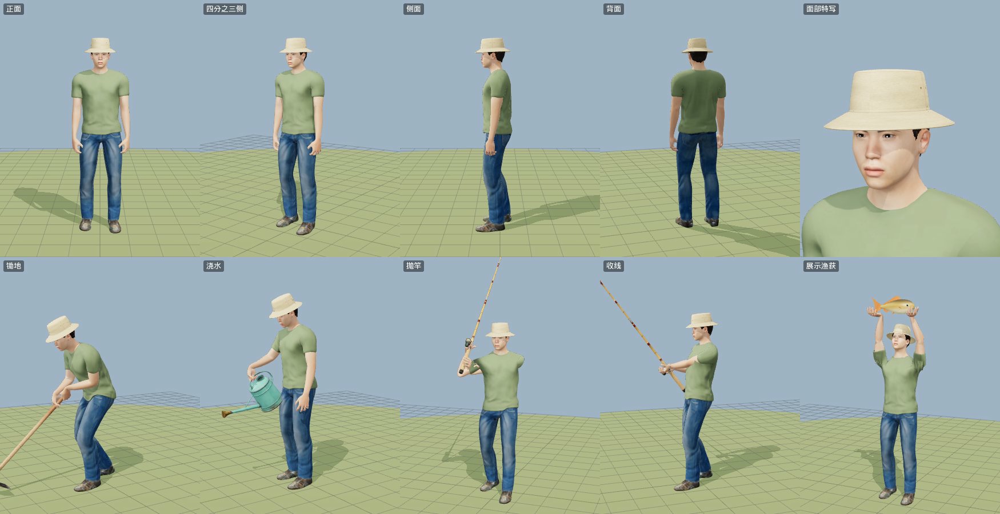

# 人物模型 · 农夫（渔夫帽 + 休闲装）



游戏主角：一位戴渔夫帽、穿短袖 T 恤和牛仔裤的青年。写实比例，带完整的游戏骨骼和蒙皮，所有动作都在游戏里实时程序化生成（见文末“动画系统”）。

| 项目 | 规格 |
|---|---|
| 身高 | 约 1.75 m（帽顶约 1.84 m） |
| 人体 | MakeHuman 人体（男性、25 岁左右、偏亚洲面孔、体型匀称略结实），皮肤 `young_asian_male` |
| 服装 | 鼠尾草绿短袖 T 恤 + 蓝色牛仔裤（MakeHuman `male_casualsuit06`，重新上色、去掉了衣服上的 logo、烘入 AO）、休闲鞋 `shoes02`、短发 `short02` |
| 渔夫帽 | 脚本建模（车削轮廓 + 帽檐下垂），沙色棉帆布：帽檐一圈圈明线、帽冠拼缝、两侧铜气眼，PBR 贴图（basecolor / ORM / normal）程序化生成；刚性挂在 `head` 骨骼上 |
| 骨骼 | MPFB “Game engine” 骨架，53 根骨骼，命名与 Unreal 人形骨架一致：`Root` › `pelvis` › `spine_01…03` › `neck_01` › `head`；`clavicle_*` › `upperarm_*` › `lowerarm_*` › `hand_*` › 五指各 3 节；`thigh_*` › `calf_*` › `foot_*` › `ball_*` |
| 面数（游戏版） | 62,788 三角形：身体 17.3k、衣服 28.7k、帽子 8.8k、头发 3.3k、鞋 3.1k、眼睛 / 眉毛 / 睫毛 1.6k |
| 材质 | 8 个：skin、clothes、shoes、hair（alpha test）、brows / lashes（半透明）、eyes、hat |
| 贴图（游戏版） | WebP：皮肤 2048，衣服 1024 + 法线，头发 1024 + 法线，帽子 1024 + ORM + 法线，鞋 512，眼睛 / 眉毛 / 睫毛 256 |

## 文件

```
models/
  blend/farmer.blend.b64.part1…6   Blender 4.5 工程：骨骼 + 蒙皮 + 材质，贴图（WebP，原始分辨率）已打包进文件
  glb/farmer.glb.b64.part1…2       游戏里用的 GLB（Meshopt 压缩几何 + WebP 贴图）
  character/                       生成脚本（本目录）
  preview/character.svg            上面的预览图
```

文件太大，base64 后拆成了几段。在 `models/` 目录运行 `python3 decode.py` 会自动按顺序拼接并还原出 `blend/farmer.blend` 和 `glb/farmer.glb`。
不用 Python 的话：

| 系统 | 命令（以 blend 为例） |
|---|---|
| macOS / Linux | `cat farmer.blend.b64.part1 farmer.blend.b64.part2 farmer.blend.b64.part3 farmer.blend.b64.part4 farmer.blend.b64.part5 farmer.blend.b64.part6 \| base64 -d > farmer.blend`（macOS 用 `base64 -D`） |
| Windows | `copy /b farmer.blend.b64.part1+farmer.blend.b64.part2+farmer.blend.b64.part3+farmer.blend.b64.part4+farmer.blend.b64.part5+farmer.blend.b64.part6 farmer.blend.b64`，再 `certutil -decode farmer.blend.b64 farmer.blend` |

`farmer.glb` 使用了 `EXT_meshopt_compression` 和 `EXT_texture_webp`：three.js（`GLTFLoader` + `MeshoptDecoder`）、Babylon.js 等可直接加载；要在 Blender 里修改请打开 `farmer.blend`。

## 生成流程

需要：Blender 4.5 + [MPFB 2](https://static.makehumancommunity.org/mpfb.html) 扩展（含 MakeHuman 系统资源包）；系统 `python3` + Pillow + numpy；Node.js（`@gltf-transform/core`、`@gltf-transform/functions`、`meshoptimizer`、`sharp`）。

| 步骤 | 脚本 | 作用 |
|---|---|---|
| 1 | `make_human.py` | 用 MPFB 无界面生成人体：体型参数、皮肤、眼睛、眉毛、睫毛、发型、衣服、鞋子、Game engine 骨架 → `out/human_raw.blend` |
| 2 | `prep_tex.py` | 处理贴图：去掉 T 恤上的 MakeHuman logo 并重新上色（保留褶皱明暗、加一点混纺麻灰噪点）、把衣服 AO 烘进颜色图、头发压暗 → `tex/` |
| 3 | `hat_tex.py` + `hat_params.json` | 渔夫帽的程序化贴图（帆布纹理、明线、拼缝、铜气眼），UV 布局与第 4 步的帽子网格一致 |
| 4 | `build_char.py` | 应用体型形变、删掉被衣服完全遮住的身体面和辅助几何、衣服平滑、把头发压进帽冠里（不穿帽）、建渔夫帽并绑到 `head` 骨骼、重建 PBR 材质、导出 → `out/farmer.blend`、`out/farmer_raw.glb` |
| 5 | `pack_char.mjs` | 压缩：每张贴图按用途缩放并转 WebP，几何用 Meshopt（保留蒙皮）→ `out/farmer.glb`（约 1 MB） |
| 6 | `emit_farmer.mjs` | 写进游戏源码：`src/assets/farmer.glb.0.js`、`farmer.glb.1.js`（base64 分段，每段 < 900 KB）+ `farmer.js` 拼接入口 |
| — | `pack_blend.py` | 把 `farmer.blend` 的外部贴图转 WebP 打包进文件、压缩保存（就是仓库里的 `farmer.blend`） |

```bash
B=/path/to/blender
$B -b -noaudio -P make_human.py
python3 prep_tex.py && python3 hat_tex.py
$B -b -noaudio -P build_char.py
node pack_char.mjs out/farmer_raw.glb out/farmer.glb
node emit_farmer.mjs out/farmer.glb ../../src/assets
$B -b out/farmer.blend -P pack_blend.py -- out/farmer_packed.blend /tmp/farmer_tex
```

脚本里的路径（`/data/char/...`、MPFB 资源目录）按自己的环境改一下即可。

## 在游戏里

- `src/assets/models.js`：`farmerModel()` 返回加载好的人物（蒙皮网格关闭视锥剔除；头发 alpha test，眉毛 / 睫毛半透明且不投影）。
- `src/game/player.js`：把人物挂到玩家节点下，四件工具用 `human.holdTool()` 放进右手；第一人称时人物换成“不写颜色、不写深度”的材质副本——看不见身体，但影子（连同头发的镂空）照样投在地上。
- `src/game/fpArms.js`：第一人称的手臂——`models.js` 在人物刚加载时用 `SkeletonUtils.clone` 克隆的第二份人物（`farmerArmsModel()`），只保留按蒙皮权重切出的两条手臂（皮肤 + T 恤袖子），用下面同一套两段 IK 和手指弯曲摆到工具上；`src/game/viewmodel.js` 负责手势和手里的工具。

## 动画系统（`src/game/human.js`）

没有使用预先录制的动画片段，所有动作都是每帧根据游戏状态实时合成的：

- **姿势通道**：骨盆位移 / 旋转、脊柱、头部、锁骨、双脚目标（位置、朝向、脚跟抬起、脚尖弯曲、膝盖方向）、双臂（前举、外展、扭转、屈肘、旋前、腕部、握拳程度）、右手持具目标、左手目标（独立 / 握在工具上 / 握摇轮把手）。
- **步态**：按速度连续变化的步频、支撑相比例、步幅、抬脚高度；走 → 慢跑 → 快跑平滑过渡（快跑有腾空相、蹬地后脚跟上踢）；脚着地时滚过脚跟 → 全掌 → 前脚掌，按地形高度贴地；骨盆起伏 / 左右摆 / 转动，手臂与腿反向摆动，转弯时身体内倾；落脚时触发脚步声。
- **待机**：呼吸、重心左右缓慢转移、偶尔四处张望；跳跃时收腿、落地屈膝缓冲。
- **持具姿势**：锄头扛在肩上，水壶垂手提着，鱼竿斜握在身前，种子袋拿在胸前；走动时随步伐轻晃。
- **动作关键帧**（单调 Hermite 插值）：锄地（举过右肩 → 下劈 → 锄板入土 → 回拉 → 扛回肩上，左手握柄）、浇水（抬壶倾倒，轻微抖动）、装水（蹲下把壶浸进水里）、播种（蹲下，左手在土里按坑，右手撒种）、收获（蹲下拔起作物，右手按所持工具不同分别竖握 / 放在身侧）、抛竿蓄力（随力度条后仰）、抛竿、等鱼 / 收线（左手摇轮，鱼竿随拉力弯曲上扬，身体后仰）、举起渔获（双手托鱼举过头顶）。
- **求解**：两段骨骼 IK（手臂、腿，带肘 / 膝方向控制），腿伸不到时自动降低骨盆；手指按握持的工具弯曲；动作之间按动作类型 0.12–0.25 秒交叉淡入淡出。

## 授权

- 人体、皮肤、眼睛、眉毛、睫毛、发型、衣服、鞋子：MakeHuman 系统资源，**CC0 1.0**（公共领域）。
- MPFB 2：GPL v3（只用于生成，不随游戏分发）。
- 渔夫帽、贴图处理、脚本：本项目原创。
